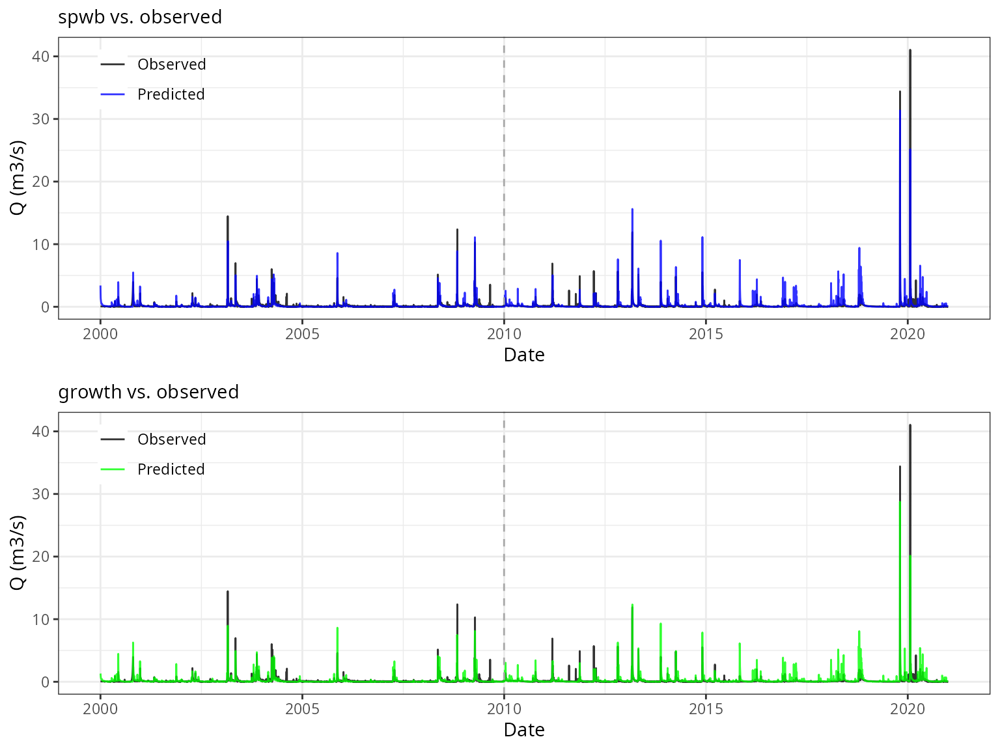
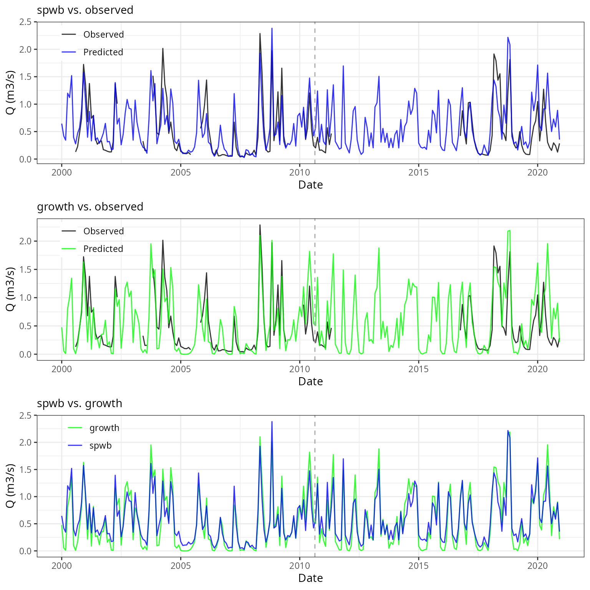
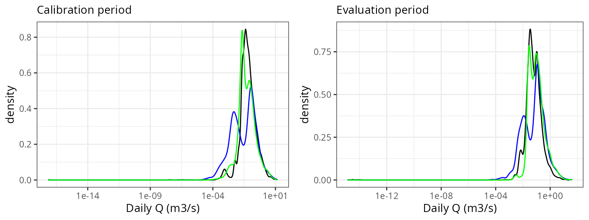
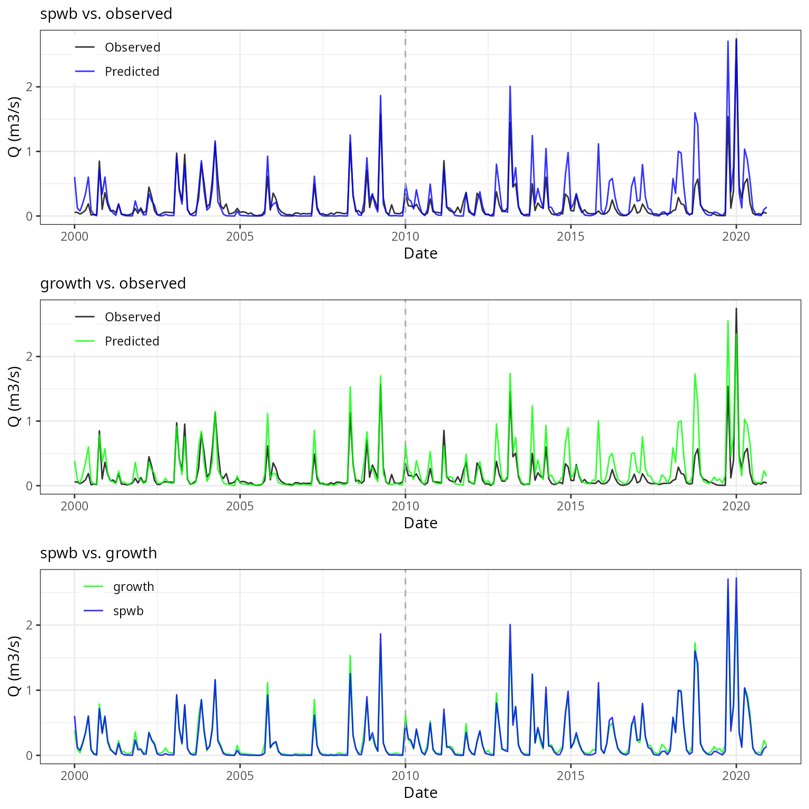

# Evaluation of watershed-level runoff against river gauge data

## Introduction

### Goal

The aim of this article is to provide an assessment of the predictive
performance of
[`spwb_land()`](https://emf-creaf.github.io/medfateland/reference/spwb_land.md)
and
[`growth_land()`](https://emf-creaf.github.io/medfateland/reference/spwb_land.md)
for the prediction of watershed outflow. To this aim, we simulate
hydrological processes in a set of benchmark watersheds and compare the
model predictions of watershed outflow against measurements obtained
using river gauges at watershed outlets. Simulations are performed after
calibrating watershed-level hydrological parameters with a subset of
observations. The vignette also includes estimates of computation time
for each watershed under different models and control parameters.

### Calibration and simulation

For each watershed, the following procedure has been conducted:

1.  Initial warm-up simulation with default parameters for a specified
    number of years, aimed to fill the aquifer and equilibrate soils.
2.  Calibration of watershed parameters for a specific period (warm-up +
    analysis) using a genetic algorithm and Kling–Gupta efficiency (KGE)
    as optimization function. Calibration is conducted with the same
    function (either
    [`spwb_land()`](https://emf-creaf.github.io/medfateland/reference/spwb_land.md)
    or
    [`growth_land()`](https://emf-creaf.github.io/medfateland/reference/spwb_land.md)
    to be used in evaluation).
3.  Simulation with calibrated watershed parameters for the whole
    period, that includes both the calibration period and a later period
    used for independent evaluation.

Both in the calibration procedure and the final simulations with
calibrated parameters, the vegetation input has been aggregated into
size classes, for computational simplicity.

### Evaluation

For each watershed, simulation results are compared to observed
watershed outflow, differentiating between the period used for
calibration and a posterior period used for independent evaluation.

**Time series**

A comparison of observed vs. simulated (with
[`spwb_land()`](https://emf-creaf.github.io/medfateland/reference/spwb_land.md)
or
[`growth_land()`](https://emf-creaf.github.io/medfateland/reference/spwb_land.md))
time series is shown, at the daily and monthly scales.

**Goodness-of-fit statistics**

The following goodness of fit statistics are calculated using package
`hydroGOF`:

- Nash-Sutcliffe Efficiency (NSE): This coefficient is sensitive to
  extreme values and might yield sub-optimal results when the dataset
  contains large outliers.
- Kling–Gupta efficiency (KGE): Provides a decomposition of the
  Nash-Sutcliffe efficiency, which facilitates the analysis of the
  importance of different components (bias, correlation and
  variability).
- Index of agreement (d): Initially proposed by Willmott (1981) to
  overcome the drawbacks of the R2, such as the differences in observed
  and predicted means and variances (Legates and McCabe, 1999). d is
  also dimensionless and bounded between 0 and 1 and can be interpreted
  similarly to R2.
- Volumetric efficiency index (VE): Originally proposed by Criss and
  Winston (2008) to circumvent some of the NSE flaws. VE values are also
  bounded \[0, 1\] and represent the fraction of water delivered at the
  proper time.
- Root mean squared error (RMSE): The usual estimation of average model
  error (i.e. the square root of mean squared errors).

**Hydrological analysis**

The density distribution and percentiles of daily discharge are compared
between observations and predictions, for both the calibration and
evaluation periods.

### Computation times

For each watershed, we provide a table of computation times in seconds
corresponding to 30-day simulations of watershed processes, with either
[`spwb_land()`](https://emf-creaf.github.io/medfateland/reference/spwb_land.md)
or
[`growth_land()`](https://emf-creaf.github.io/medfateland/reference/spwb_land.md).
Different combinations of control parameters are tested for
`transpirationMode` (either Granier or Sureau), `rhizosphereOverlap`
(either total or partial) or `soilDomains` (either single or dual).
Different degrees of vegetation detail are also tested: (a) tree-level
original inventory records; (b) aggregation of trees and shrubs into
size classes; (c) simplification to the dominant tree/shrub species.

## Calibrated watershed parameters

The following table contains the period of calibration and the set of
TETIS parameters resulting from calibration exercises with either
[`spwb_land()`](https://emf-creaf.github.io/medfateland/reference/spwb_land.md)
or
[`growth_land()`](https://emf-creaf.github.io/medfateland/reference/spwb_land.md):

| medfateland | medfate | model | watershed | local_model | Calibration_start | Calibration_end | R_localflow | R_interflow | R_baseflow | n_interflow | n_baseflow | n_manning | num_daily_substeps | rock_max_infiltration | deep_aquifer_loss |
|:---|:---|:---|:---|:---|:---|:---|---:|---:|---:|---:|---:|---:|---:|---:|---:|
| 3.0.1 | 5.2.1 | tetis | aiguadora | growth | 2000-08-22 | 2010-08-22 | 3.6159824 | 3.832074 | 0.312165 | 0.0816264 | 1.8170505 | 0.0906169 | 24 | 10 | 4.3222517 |
| 3.0.1 | 5.2.1 | tetis | aiguadora | spwb | 2000-08-22 | 2010-08-22 | 0.3695427 | 1.995859 | 2.335199 | 0.0980868 | 0.8831705 | 0.0332626 | 24 | 10 | 3.4474143 |
| 3.0.1 | 5.2.1 | tetis | siurana | growth | 2000-01-01 | 2009-12-31 | 0.5011519 | 4.080921 | 3.678624 | 0.0480280 | 1.4437293 | 0.0709350 | 24 | 10 | 1.4499759 |
| 3.0.1 | 5.2.1 | tetis | siurana | spwb | 2000-01-01 | 2009-12-31 | 0.5641670 | 4.838113 | 2.429330 | 0.0212023 | 1.7348234 | 0.0251805 | 24 | 10 | 0.8616281 |

## Evaluation results

### AIGUADORA watershed with TETIS and version 3.0.1

#### Goodness-of-fit

| Scale   | Period      | Local.model |    NSE |   KGE |     d |    VE |  RMSE |
|:--------|:------------|:------------|-------:|------:|------:|------:|------:|
| Daily   | Calibration | spwb        |  0.606 | 0.801 | 0.730 | 0.508 | 0.517 |
| Daily   | Calibration | growth      |  0.545 | 0.770 | 0.696 | 0.446 | 0.556 |
| Daily   | Evaluation  | spwb        | -0.558 | 0.304 | 0.489 | 0.149 | 0.845 |
| Daily   | Evaluation  | growth      | -0.525 | 0.293 | 0.474 | 0.124 | 0.836 |
| Monthly | Calibration | spwb        |  0.722 | 0.789 | 0.761 | 0.612 | 0.280 |
| Monthly | Calibration | growth      |  0.683 | 0.831 | 0.737 | 0.573 | 0.299 |
| Monthly | Evaluation  | spwb        |  0.188 | 0.477 | 0.548 | 0.357 | 0.422 |
| Monthly | Evaluation  | growth      |  0.130 | 0.468 | 0.555 | 0.367 | 0.437 |

#### Time series

*Daily*

*Monthly*

#### Hydrological analysis (daily scale)

*Density distribution*

*Percentiles*

|  | Observed.calibration | spwb.calibration | growth.calibration | Observed.Evaluation | spwb.Evaluation | growth.Evaluation |
|:---|---:|---:|---:|---:|---:|---:|
| 1% | 0.0300 | 0.02789 | 0.00000 | 0.0600 | 0.05877 | 0.00000 |
| 5% | 0.0500 | 0.04342 | 0.00000 | 0.0700 | 0.09634 | 0.00000 |
| 10% | 0.0600 | 0.07847 | 0.00061 | 0.0900 | 0.13814 | 0.00912 |
| 15% | 0.0800 | 0.10964 | 0.01217 | 0.1000 | 0.17118 | 0.01572 |
| 25% | 0.1000 | 0.17045 | 0.03068 | 0.1300 | 0.21674 | 0.04417 |
| 50% | 0.2600 | 0.28925 | 0.26758 | 0.2700 | 0.32096 | 0.32848 |
| 75% | 0.5700 | 0.55599 | 0.61639 | 0.5400 | 0.63777 | 0.67359 |
| 85% | 0.9300 | 0.87896 | 0.92983 | 0.8500 | 0.97909 | 1.02191 |
| 90% | 1.2400 | 1.16132 | 1.28442 | 1.1700 | 1.29088 | 1.39332 |
| 95% | 1.8500 | 1.86324 | 2.06505 | 1.7660 | 2.02002 | 2.37650 |
| 99% | 3.7998 | 4.01228 | 3.95803 | 3.3616 | 4.85995 | 4.50680 |

#### Computation times

| medfateland_ver | medfate_ver | watershed | model | transpirationMode | soilDomains | rhizosphereOverlap | input | days | Elapsed_time_sec |
|:---|:---|:---|:---|:---|:---|:---|:---|---:|---:|
| 3.0.1 | 5.2.1 | aiguadora | spwb | Granier | single | total | dominant species | 30 | 8.415 |
| 3.0.1 | 5.2.1 | aiguadora | spwb | Granier | dual | total | dominant species | 30 | 7.896 |
| 3.0.1 | 5.2.1 | aiguadora | spwb | Granier | single | total | size classes | 30 | 8.326 |
| 3.0.1 | 5.2.1 | aiguadora | spwb | Granier | dual | total | size classes | 30 | 8.383 |
| 3.0.1 | 5.2.1 | aiguadora | spwb | Granier | single | total | original inventory | 30 | 9.386 |
| 3.0.1 | 5.2.1 | aiguadora | spwb | Granier | dual | total | original inventory | 30 | 9.390 |
| 3.0.1 | 5.2.1 | aiguadora | spwb | Granier | single | partial | dominant species | 30 | 8.703 |
| 3.0.1 | 5.2.1 | aiguadora | spwb | Granier | dual | partial | dominant species | 30 | 9.312 |
| 3.0.1 | 5.2.1 | aiguadora | spwb | Granier | single | partial | size classes | 30 | 16.937 |
| 3.0.1 | 5.2.1 | aiguadora | spwb | Granier | dual | partial | size classes | 30 | 18.531 |
| 3.0.1 | 5.2.1 | aiguadora | spwb | Granier | single | partial | original inventory | 30 | 38.278 |
| 3.0.1 | 5.2.1 | aiguadora | spwb | Granier | dual | partial | original inventory | 30 | 42.809 |
| 3.0.1 | 5.2.1 | aiguadora | spwb | Sureau | single | total | dominant species | 30 | 37.027 |
| 3.0.1 | 5.2.1 | aiguadora | spwb | Sureau | dual | total | dominant species | 30 | 37.192 |
| 3.0.1 | 5.2.1 | aiguadora | spwb | Sureau | single | total | size classes | 30 | 126.179 |
| 3.0.1 | 5.2.1 | aiguadora | spwb | Sureau | dual | total | size classes | 30 | 126.138 |
| 3.0.1 | 5.2.1 | aiguadora | spwb | Sureau | single | total | original inventory | 30 | 318.616 |
| 3.0.1 | 5.2.1 | aiguadora | spwb | Sureau | dual | total | original inventory | 30 | 317.690 |
| 3.0.1 | 5.2.1 | aiguadora | spwb | Sureau | single | partial | dominant species | 30 | 37.842 |
| 3.0.1 | 5.2.1 | aiguadora | spwb | Sureau | dual | partial | dominant species | 30 | 37.896 |
| 3.0.1 | 5.2.1 | aiguadora | spwb | Sureau | single | partial | size classes | 30 | 164.389 |
| 3.0.1 | 5.2.1 | aiguadora | spwb | Sureau | dual | partial | size classes | 30 | 167.807 |
| 3.0.1 | 5.2.1 | aiguadora | spwb | Sureau | single | partial | original inventory | 30 | 655.261 |
| 3.0.1 | 5.2.1 | aiguadora | spwb | Sureau | dual | partial | original inventory | 30 | 661.018 |
| 3.0.1 | 5.2.1 | aiguadora | growth | Granier | single | total | dominant species | 30 | 9.218 |
| 3.0.1 | 5.2.1 | aiguadora | growth | Granier | dual | total | dominant species | 30 | 8.939 |
| 3.0.1 | 5.2.1 | aiguadora | growth | Granier | single | total | size classes | 30 | 9.907 |
| 3.0.1 | 5.2.1 | aiguadora | growth | Granier | dual | total | size classes | 30 | 9.891 |
| 3.0.1 | 5.2.1 | aiguadora | growth | Granier | single | total | original inventory | 30 | 12.258 |
| 3.0.1 | 5.2.1 | aiguadora | growth | Granier | dual | total | original inventory | 30 | 12.380 |
| 3.0.1 | 5.2.1 | aiguadora | growth | Granier | single | partial | dominant species | 30 | 9.727 |
| 3.0.1 | 5.2.1 | aiguadora | growth | Granier | dual | partial | dominant species | 30 | 9.899 |
| 3.0.1 | 5.2.1 | aiguadora | growth | Granier | single | partial | size classes | 30 | 19.282 |
| 3.0.1 | 5.2.1 | aiguadora | growth | Granier | dual | partial | size classes | 30 | 20.636 |
| 3.0.1 | 5.2.1 | aiguadora | growth | Granier | single | partial | original inventory | 30 | 42.363 |
| 3.0.1 | 5.2.1 | aiguadora | growth | Granier | dual | partial | original inventory | 30 | 46.391 |
| 3.0.1 | 5.2.1 | aiguadora | growth | Sureau | single | total | dominant species | 30 | 93.533 |
| 3.0.1 | 5.2.1 | aiguadora | growth | Sureau | dual | total | dominant species | 30 | 94.081 |
| 3.0.1 | 5.2.1 | aiguadora | growth | Sureau | single | total | size classes | 30 | 395.877 |
| 3.0.1 | 5.2.1 | aiguadora | growth | Sureau | dual | total | size classes | 30 | 417.029 |
| 3.0.1 | 5.2.1 | aiguadora | growth | Sureau | single | total | original inventory | 30 | 1235.768 |
| 3.0.1 | 5.2.1 | aiguadora | growth | Sureau | dual | total | original inventory | 30 | 1788.023 |
| 3.0.1 | 5.2.1 | aiguadora | growth | Sureau | single | partial | dominant species | 30 | 174.430 |
| 3.0.1 | 5.2.1 | aiguadora | growth | Sureau | dual | partial | dominant species | 30 | 176.027 |
| 3.0.1 | 5.2.1 | aiguadora | growth | Sureau | single | partial | size classes | 30 | 788.704 |
| 3.0.1 | 5.2.1 | aiguadora | growth | Sureau | dual | partial | size classes | 30 | 781.141 |
| 3.0.1 | 5.2.1 | aiguadora | growth | Sureau | single | partial | original inventory | 30 | 2294.495 |
| 3.0.1 | 5.2.1 | aiguadora | growth | Sureau | dual | partial | original inventory | 30 | 2232.885 |

### SIURANA watershed with TETIS and version 3.0.1

#### Goodness-of-fit

| Scale   | Period      | Local.model |   NSE |   KGE |     d |     VE |  RMSE |
|:--------|:------------|:------------|------:|------:|------:|-------:|------:|
| Daily   | Calibration | spwb        | 0.413 | 0.717 | 0.694 |  0.292 | 0.429 |
| Daily   | Calibration | growth      | 0.442 | 0.723 | 0.697 |  0.298 | 0.418 |
| Daily   | Evaluation  | spwb        | 0.533 | 0.739 | 0.535 | -0.072 | 0.678 |
| Daily   | Evaluation  | growth      | 0.438 | 0.700 | 0.525 | -0.097 | 0.744 |
| Monthly | Calibration | spwb        | 0.830 | 0.856 | 0.798 |  0.588 | 0.110 |
| Monthly | Calibration | growth      | 0.797 | 0.833 | 0.801 |  0.595 | 0.120 |
| Monthly | Evaluation  | spwb        | 0.232 | 0.376 | 0.540 |  0.112 | 0.279 |
| Monthly | Evaluation  | growth      | 0.265 | 0.431 | 0.524 |  0.080 | 0.273 |

#### Time series

*Daily*

*Monthly*

#### Hydrological analysis (daily scale)

*Density distribution*

*Percentiles*

|  | Observed.calibration | spwb.calibration | growth.calibration | Observed.Evaluation | spwb.Evaluation | growth.Evaluation |
|:---|---:|---:|---:|---:|---:|---:|
| 1% | 0.00000 | 0.00000 | 0.00000 | 0.00000 | 0.00000 | 0.00461 |
| 5% | 0.00000 | 0.00000 | 0.00184 | 0.00000 | 0.00166 | 0.02027 |
| 10% | 0.00137 | 0.00000 | 0.00708 | 0.00731 | 0.00437 | 0.02404 |
| 15% | 0.01160 | 0.00000 | 0.01197 | 0.01500 | 0.00643 | 0.02708 |
| 25% | 0.02310 | 0.00172 | 0.01935 | 0.02500 | 0.01208 | 0.03522 |
| 50% | 0.05120 | 0.01286 | 0.03991 | 0.05050 | 0.08641 | 0.08877 |
| 75% | 0.12500 | 0.11884 | 0.12142 | 0.12000 | 0.20379 | 0.20415 |
| 85% | 0.21990 | 0.21843 | 0.21527 | 0.19241 | 0.35346 | 0.36086 |
| 90% | 0.32996 | 0.32890 | 0.34216 | 0.27199 | 0.52346 | 0.58793 |
| 95% | 0.67227 | 0.59707 | 0.71914 | 0.50707 | 1.08479 | 1.13670 |
| 99% | 2.06434 | 2.81922 | 2.70664 | 1.94395 | 4.02188 | 3.88606 |

#### Computation times

| medfateland_ver | medfate_ver | watershed | model | transpirationMode | soilDomains | rhizosphereOverlap | input | days | Elapsed_time_sec |
|:---|:---|:---|:---|:---|:---|:---|:---|---:|---:|
| 3.0.1 | 5.2.1 | siurana | spwb | Granier | single | total | dominant species | 30 | 4.127 |
| 3.0.1 | 5.2.1 | siurana | spwb | Granier | dual | total | dominant species | 30 | 3.971 |
| 3.0.1 | 5.2.1 | siurana | spwb | Granier | single | total | size classes | 30 | 4.407 |
| 3.0.1 | 5.2.1 | siurana | spwb | Granier | dual | total | size classes | 30 | 4.526 |
| 3.0.1 | 5.2.1 | siurana | spwb | Granier | single | total | original inventory | 30 | 4.718 |
| 3.0.1 | 5.2.1 | siurana | spwb | Granier | dual | total | original inventory | 30 | 4.825 |
| 3.0.1 | 5.2.1 | siurana | spwb | Granier | single | partial | dominant species | 30 | 4.446 |
| 3.0.1 | 5.2.1 | siurana | spwb | Granier | dual | partial | dominant species | 30 | 4.675 |
| 3.0.1 | 5.2.1 | siurana | spwb | Granier | single | partial | size classes | 30 | 13.869 |
| 3.0.1 | 5.2.1 | siurana | spwb | Granier | dual | partial | size classes | 30 | 15.710 |
| 3.0.1 | 5.2.1 | siurana | spwb | Granier | single | partial | original inventory | 30 | 20.953 |
| 3.0.1 | 5.2.1 | siurana | spwb | Granier | dual | partial | original inventory | 30 | 23.457 |
| 3.0.1 | 5.2.1 | siurana | spwb | Sureau | single | total | dominant species | 30 | 18.773 |
| 3.0.1 | 5.2.1 | siurana | spwb | Sureau | dual | total | dominant species | 30 | 18.985 |
| 3.0.1 | 5.2.1 | siurana | spwb | Sureau | single | total | size classes | 30 | 98.253 |
| 3.0.1 | 5.2.1 | siurana | spwb | Sureau | dual | total | size classes | 30 | 98.448 |
| 3.0.1 | 5.2.1 | siurana | spwb | Sureau | single | total | original inventory | 30 | 152.710 |
| 3.0.1 | 5.2.1 | siurana | spwb | Sureau | dual | total | original inventory | 30 | 152.636 |
| 3.0.1 | 5.2.1 | siurana | spwb | Sureau | single | partial | dominant species | 30 | 19.123 |
| 3.0.1 | 5.2.1 | siurana | spwb | Sureau | dual | partial | dominant species | 30 | 19.406 |
| 3.0.1 | 5.2.1 | siurana | spwb | Sureau | single | partial | size classes | 30 | 156.816 |
| 3.0.1 | 5.2.1 | siurana | spwb | Sureau | dual | partial | size classes | 30 | 159.049 |
| 3.0.1 | 5.2.1 | siurana | spwb | Sureau | single | partial | original inventory | 30 | 305.405 |
| 3.0.1 | 5.2.1 | siurana | spwb | Sureau | dual | partial | original inventory | 30 | 310.397 |
| 3.0.1 | 5.2.1 | siurana | growth | Granier | single | total | dominant species | 30 | 4.575 |
| 3.0.1 | 5.2.1 | siurana | growth | Granier | dual | total | dominant species | 30 | 4.557 |
| 3.0.1 | 5.2.1 | siurana | growth | Granier | single | total | size classes | 30 | 5.753 |
| 3.0.1 | 5.2.1 | siurana | growth | Granier | dual | total | size classes | 30 | 5.882 |
| 3.0.1 | 5.2.1 | siurana | growth | Granier | single | total | original inventory | 30 | 6.723 |
| 3.0.1 | 5.2.1 | siurana | growth | Granier | dual | total | original inventory | 30 | 6.524 |
| 3.0.1 | 5.2.1 | siurana | growth | Granier | single | partial | dominant species | 30 | 5.168 |
| 3.0.1 | 5.2.1 | siurana | growth | Granier | dual | partial | dominant species | 30 | 5.725 |
| 3.0.1 | 5.2.1 | siurana | growth | Granier | single | partial | size classes | 30 | 15.585 |
| 3.0.1 | 5.2.1 | siurana | growth | Granier | dual | partial | size classes | 30 | 17.356 |
| 3.0.1 | 5.2.1 | siurana | growth | Granier | single | partial | original inventory | 30 | 23.124 |
| 3.0.1 | 5.2.1 | siurana | growth | Granier | dual | partial | original inventory | 30 | 25.805 |
| 3.0.1 | 5.2.1 | siurana | growth | Sureau | single | total | dominant species | 30 | 54.677 |
| 3.0.1 | 5.2.1 | siurana | growth | Sureau | dual | total | dominant species | 30 | 54.864 |
| 3.0.1 | 5.2.1 | siurana | growth | Sureau | single | total | size classes | 30 | 421.179 |
| 3.0.1 | 5.2.1 | siurana | growth | Sureau | dual | total | size classes | 30 | 422.184 |
| 3.0.1 | 5.2.1 | siurana | growth | Sureau | single | total | original inventory | 30 | 657.263 |
| 3.0.1 | 5.2.1 | siurana | growth | Sureau | dual | total | original inventory | 30 | 657.151 |
| 3.0.1 | 5.2.1 | siurana | growth | Sureau | single | partial | dominant species | 30 | 55.108 |
| 3.0.1 | 5.2.1 | siurana | growth | Sureau | dual | partial | dominant species | 30 | 55.465 |
| 3.0.1 | 5.2.1 | siurana | growth | Sureau | single | partial | size classes | 30 | 479.278 |
| 3.0.1 | 5.2.1 | siurana | growth | Sureau | dual | partial | size classes | 30 | 480.236 |
| 3.0.1 | 5.2.1 | siurana | growth | Sureau | single | partial | original inventory | 30 | 824.497 |
| 3.0.1 | 5.2.1 | siurana | growth | Sureau | dual | partial | original inventory | 30 | 875.495 |
