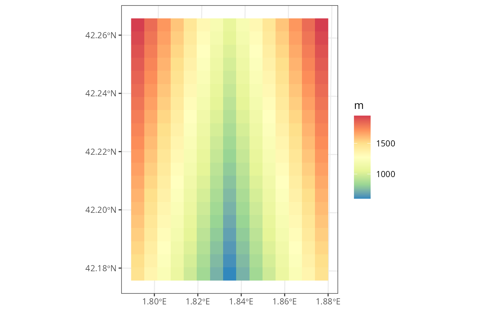

# Sensitivity to watershed parameters

## Introduction

The aim of this vignette is to illustrate the sensitivity of watershed
ecohydrological simulations (e.g. via
[`spwb_land()`](https://emf-creaf.github.io/medfateland/reference/spwb_land.md))
to variations in three watershed parameters for sub-model TETIS. A
global sensitivity analysis was carried out to identify which parameters
users should focus on when calibrating MEDFATELAND and which can be
fixed at default values.

## Sensitivity analysis procedure

### Synthetic catchment

To characterise the hydrological behaviour of the model independently of
a particular catchment, the analysis was performed on a synthetic
catchment of 15 x 20 = 300 cells at 500 m resolution (750 ha),
representing a linear valley with 5% slope and lateral hill slopes with
25% slope. All cells had aforest consisting of a single cohort of Pinus
nigra trees of 8m height, 20 cm DBH and stand LAI = 2; and a soil taken
from a cell in Aiguadora catchment. Daily weather forcing was also taken
from the same catchment. Watershed hydrology simulations were run using
the
[`spwb_land()`](https://emf-creaf.github.io/medfateland/reference/spwb_land.md)
function and included a warm-up period (2000-2010) followed by the
analysis period (2011-2020).

The following shows the `sf` object representing the synthetic
catchment:

``` r

sensitivity_path = "~/mcaceres_work/model_development/medfateland_sensitivity/data/SA_morris_results_single_DTB40000/"
ws_sf <- sf::st_as_sf(tibble::as_tibble(readRDS(file.path(sensitivity_path,"ws_sf.rds"))))
ws_sf
```

    ## Simple feature collection with 300 features and 12 fields
    ## Geometry type: POINT
    ## Dimension:     XY
    ## Bounding box:  xmin: 400250 ymin: 4670250 xmax: 407250 ymax: 4679750
    ## Projected CRS: WGS 84 / UTM zone 31N
    ## # A tibble: 300 × 13
    ##            geometry    id elevation slope aspect land_cover_type
    ##         <POINT [m]> <int>     <dbl> <dbl>  <dbl> <chr>          
    ##  1 (400250 4679750)     1      1950 14.3    101. wildland       
    ##  2 (400750 4679750)     2      1825 14.3    101. wildland       
    ##  3 (401250 4679750)     3      1700 14.3    101. wildland       
    ##  4 (401750 4679750)     4      1575 14.3    101. wildland       
    ##  5 (402250 4679750)     5      1450 14.3    101. wildland       
    ##  6 (402750 4679750)     6      1325 14.3    101. wildland       
    ##  7 (403250 4679750)     7      1200 14.3    101. wildland       
    ##  8 (403750 4679750)     8      1075  2.86   180  wildland       
    ##  9 (404250 4679750)     9      1200 14.3    259. wildland       
    ## 10 (404750 4679750)    10      1325 14.3    259. wildland       
    ## # ℹ 290 more rows
    ## # ℹ 7 more variables: forest <list>, soil <list>, depth_to_bedrock <dbl>,
    ## #   bedrock_conductivity <dbl>, bedrock_porosity <dbl>, channel <lgl>,
    ## #   result_cell <lgl>

Another spatial input is needed to describe the grid topology, which in
our case is an object of class `SpatRaster` from package **terra**
matching the coordinate definition in the `sf` object:

``` r

nx <- 15
ny <- 20
res <- 500
xmin <- 400000
ymin <- 4670000
crs <- "epsg:32631"
r <- terra::rast(xmin = xmin, xmax = xmin + nx * res,
                   ymin = ymin, ymax = ymin + ny * res,
                   nrows = ny, ncols = nx, crs = crs)
```

The topography of the synthetic watershed looks as follows:

``` r

plot_variable(ws_sf, variable = "elevation", r = r)
```



### Design of parameter exploration

The analysis considered the seven effective parameters of the lateral
and vertical flow formulation: $`n_{\mathrm{interflow}}`$,
$`n_{\mathrm{baseflow}}`$, $`R_{\mathrm{localflow}}`$,
$`R_{\mathrm{interflow}}`$, $`R_{\mathrm{baseflow}}`$,
$`D_{\mathrm{loss}}`$ and $`n_{\mathrm{Manning}}`$. The following table
provides parameter limits for exploration, as well as default values for
a reference run (see below), and indicates whether sampling is performed
on a logarithmic scale:

``` r

par_def <- data.frame(
  name  = c("n_interflow", "n_baseflow", "R_localflow", "R_interflow",
            "R_baseflow", "deep_aquifer_loss", "n_manning"),
  label = c("n[interflow]", "n[baseflow]", "R[localflow]", "R[interflow]",
            "R[baseflow]", "D[loss]", "n[Manning]"),
  log10 = c(TRUE,  FALSE, TRUE,  TRUE,  TRUE,  FALSE, FALSE),
  min   = c(0.01,  0.01,   0.1,   0.1,     0.1,   0,     0.01),
  max   = c(2,     2,     20,    20,   20,    5,     0.1),
  ref   = c(0.08391252,   0.57094430,  0.87305020,     1.65763220,     
            0.21474088,   3.73822300,  0.06943110), 
  stringsAsFactors = FALSE
)
par_def
```

    ##                name        label log10  min  max        ref
    ## 1       n_interflow n[interflow]  TRUE 0.01  2.0 0.08391252
    ## 2        n_baseflow  n[baseflow] FALSE 0.01  2.0 0.57094430
    ## 3       R_localflow R[localflow]  TRUE 0.10 20.0 0.87305020
    ## 4       R_interflow R[interflow]  TRUE 0.10 20.0 1.65763220
    ## 5        R_baseflow  R[baseflow]  TRUE 0.10 20.0 0.21474088
    ## 6 deep_aquifer_loss      D[loss] FALSE 0.00  5.0 3.73822300
    ## 7         n_manning   n[Manning] FALSE 0.01  0.1 0.06943110

As procedure for sensitivity analysis we used the elementary effects
method of Morris, implemented in function `morris()` (of package
**sensitivity**), which provides a robust ranking of parameter
importance at a small fraction of the cost of variance-based methods.
Each parameter was sampled over the range given in the previous table,
discretised into six levels, and $`r = 20`$ trajectories were generated,
giving $`r(k+1) = 160`$ model runs for $`k = 7`$ parameters:

``` r

r_traj <- 20 # Number of trajectories
n_levels <- 6 # Number of levels for each parameter

# Limits in the sampling scale (logarithmic for some parameters)
binf <- ifelse(par_def$log10, log10(par_def$min), par_def$min)
bsup <- ifelse(par_def$log10, log10(par_def$max), par_def$max)

# Morris design
mo <- sensitivity::morris(model = NULL, factors = par_def$name, r = r_traj,
                          design = list(type = "oat", levels = n_levels,
                                        grid.jump = n_levels / 2),
                          binf = binf, bsup = bsup, scale = TRUE)
```

    ## Registered S3 method overwritten by 'sensitivity':
    ##   method    from 
    ##   print.src dplyr

``` r

dim(mo$X)
```

    ## [1] 160   7

``` r

head(mo$X)
```

    ##      n_interflow n_baseflow R_localflow R_interflow R_baseflow
    ## [1,]    0.301030      1.204   -0.539794    0.840824   1.301030
    ## [2,]    0.301030      1.204   -0.539794    0.840824   1.301030
    ## [3,]    0.301030      1.204   -0.539794   -0.539794   1.301030
    ## [4,]   -1.079588      1.204   -0.539794   -0.539794   1.301030
    ## [5,]   -1.079588      1.204   -0.539794   -0.539794  -0.079588
    ## [6,]   -1.079588      1.204   -0.539794   -0.539794  -0.079588
    ##      deep_aquifer_loss n_manning
    ## [1,]                 2     0.082
    ## [2,]                 2     0.028
    ## [3,]                 2     0.028
    ## [4,]                 2     0.028
    ## [5,]                 2     0.028
    ## [6,]                 5     0.028

### Simulations

We first run
[`spwb_land()`](https://emf-creaf.github.io/medfateland/reference/spwb_land.md)
on the synthetic watershed with parameters calibrated for the Aiguadora
catchment. Then, we made simulations for each of the 160 parameter
combinations of the morris design. Each simulation included 11 years of
warm-up simulation, followed by 10 years of simulation for analysis.
Simulations were conducted using 1D Richards for local soil water flows
(`soilDomains = "single"`), with a tolerance value
`richards_tolerance = 0.00001`; and 24 daily substeps were specified for
lateral processes, using the watershed control parameter
`num_daily_substeps = 24`. For all these runs, we stored the simulated
daily discharge, as well as water balance components (precipitation,
transpiration, runoff…) averaged at the watershed level.

### Response variables

Three groups of response variables were analysed. First, the Kling-Gupta
efficiency (KGE) of simulated daily discharge was computed against the
simulated discharge in reference simulation run, as an aggregate measure
of how much each parameter modifies the hydrograph. Second, six
hydrological signatures of the simulated discharge were used to identify
which aspect of the hydrological response is controlled by each
parameter. Third, the partitioning of precipitation into
evapotranspiration, surface runoff, deep drainage and losses to the deep
aquifer was analysed to assess whether hydrological parameters also
affect the balance between green and blue water, and transpiration was
included to evaluate their effect on vegetation functioning.

### Morris indices

Morris indices $`\mu*`$ and $`\sigma`$ were estimated using function
[`sensitivity::tell()`](https://rdrr.io/pkg/sensitivity/man/decoupling.html)
for each response variable. $`\mu*`$ values were normalized by response
variable to the \[0-1\] scale, in order to compare indices between
response variables that have different units.

## Results

We read the CSV corresponding to the normalized indices:

``` r

morris_indices <- readr::read_csv(file.path(sensitivity_path, "morris_indices.csv"), show_col_types = FALSE)
morris_indices
```

    ## # A tibble: 112 × 7
    ##    output parameter         label             mu mu_star sigma mu_star_norm
    ##    <chr>  <chr>             <chr>          <dbl>   <dbl> <dbl>        <dbl>
    ##  1 KGE    n_interflow       n[interflow]  1.08     1.78  1.78         1    
    ##  2 KGE    n_baseflow        n[baseflow]  -0.172    0.327 0.395        0.184
    ##  3 KGE    R_localflow       R[localflow]  0.104    0.392 0.536        0.221
    ##  4 KGE    R_interflow       R[interflow] -0.191    1.10  1.37         0.620
    ##  5 KGE    R_baseflow        R[baseflow]   0.272    0.353 0.396        0.198
    ##  6 KGE    deep_aquifer_loss D[loss]       0.110    0.325 0.466        0.183
    ##  7 KGE    n_manning         n[Manning]    0        0     0            0    
    ##  8 KGE_r  n_interflow       n[interflow]  0.135    0.546 0.614        1    
    ##  9 KGE_r  n_baseflow        n[baseflow]   0.0410   0.204 0.315        0.375
    ## 10 KGE_r  R_localflow       R[localflow] -0.0635   0.128 0.168        0.234
    ## # ℹ 102 more rows

### KGE

``` r

d_kge <- subset(morris_indices, output == "KGE")
ggplot(d_kge, aes(mu_star, sigma, label = label)) +
    geom_abline(slope = 1, intercept = 0, linetype = 2, colour = "grey60") +
    geom_point(size = 2.5) +
    geom_text(parse = TRUE, vjust = -0.8, size = 3.5) +
    labs(x = expression(mu^"*"), y = expression(sigma), title = "KGE (daily discharge)") +
    theme_bw()
```


### Heatmap

``` r

heat_out <- c("RunoffRatio", "BFI", "Q5", "Q95", "ZeroFlowFrac", "RecessionK", "HalfFlowDate",
                "ET_P", "SurfRunoff_P", "DeepDrainage_P", "DeepAqLoss_P", "Transpiration")
d_heat <- subset(morris_indices, output %in% heat_out)
d_heat$output <- factor(d_heat$output, levels = heat_out)
d_heat$label  <- factor(d_heat$label, levels = rev(par_def$label))

ggplot(d_heat, aes(output, label, fill = mu_star_norm)) +
    geom_tile(colour = "white") +
    scale_fill_gradient(low = "white", high = "#08519c", limits = c(0, 1),
                        name = expression("Normalised " * mu^"*")) +
    scale_y_discrete(labels = function(l) parse(text = l)) +
    labs(x = NULL, y = NULL) +
    theme_minimal() +
    theme(axis.text.x = element_text(angle = 45, hjust = 1))
```


